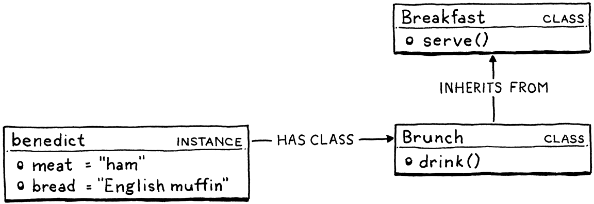
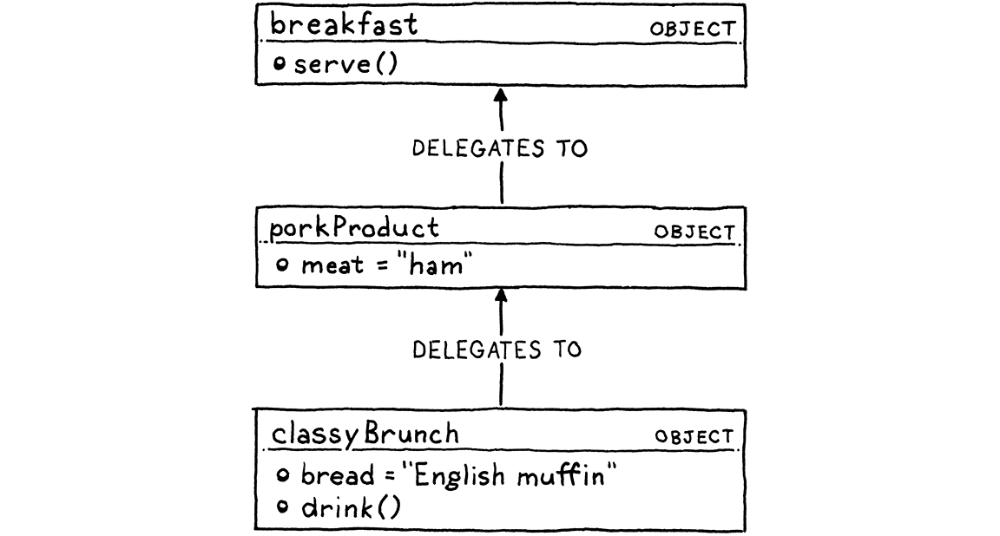

## Managing memory

2 main techniques for managing memory: reference counting and tracing garbage collection (usually just called garbage collection or GC). Ref counters are much simpler to implement—I think that’s why Perl, PHP, and Python all started out using them. But, over time, the limitations of ref counting become too troublesome. All of those languages eventually ended up adding a full tracing GC, or at least enough of one to clean up object cycles.

## Boolean

Boolean is a data type named after a person, George Boole, which is why “Boolean” is capitalized. He died in 1864, nearly a century before digital computers turned his algebra into electricity.

## Structure

- atoms: data types
- molecules: expressions
- organelle: statements. Where an expression’s main job is to produce a value, a statement’s job is to produce an effect. Since, by definition, statements don’t evaluate to a value, to be useful they have to otherwise change the world in some way—usually modifying some state, reading input, or producing output.
- variables
- functions
- closures
- classes

## Arg and param

- An argument is an actual value you pass to a function when you call it. So a function call has an argument list. Sometimes you hear actual parameter used for these.

- A parameter is a variable that holds the value of the argument inside the body of the function. Thus, a function declaration has a parameter list. Others call these formal parameters or simply formals.

## Classes or prototypes

In class-based languages, there are two core concepts: instances and classes. Instances store the state for each object and have a reference to the instance’s class. Classes contain the methods and inheritance chain. To call a method on an instance, there is always a level of indirection. You look up the instance’s class and then you find the method there:

Prototype-based languages merge these two concepts. There are only objects—no classes—and each individual object may contain state and methods. Objects can directly inherit from each other (or “delegate to” in prototypal lingo):

This means that in some ways prototypal languages are more fundamental than classes. They are really neat to implement because they’re so simple. Also, they can express lots of unusual patterns that classes steer you away from.

## Inheritance

Even the init() method gets inherited. In practice, the subclass usually wants to define its own init() method too. But the original one also needs to be called so that the superclass can maintain its state. We need some way to call a method on our own instance without hitting our own methods.

> If you wanted to turn Lox into an actual useful language, the very first thing you should do is flesh this out. String manipulation, trigonometric functions, file I/O, networking, heck, even reading input from the user would help.
